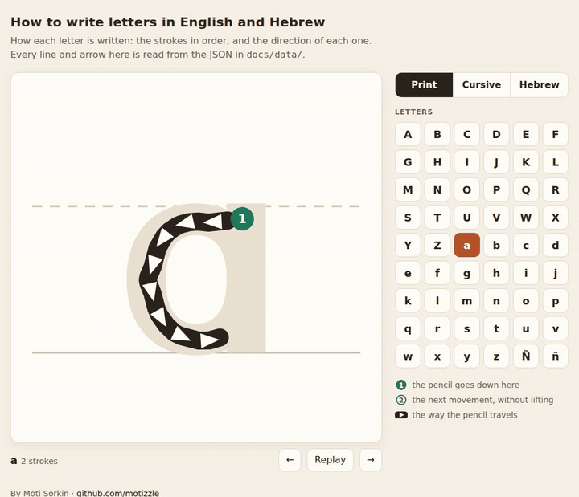

# How to write letters in English and Hebrew

How to write each letter: the strokes in order, the path of each stroke, and
arrows showing which way the pencil goes. Three alphabets are included:
printed Latin (A–Z, a–z, Ñ, ñ), cursive Latin (A–Z, a–z), and printed Hebrew.
Each one is a single JSON file that any program can draw from.

It was built for a tablet app that teaches children to write. This repository
holds the parts that are useful outside that app: the engine that makes the
stroke data, the tool used to trace the cursive alphabet, the data itself, and
a demo page.



Demo: [`docs/index.html`](docs/index.html). It plays each letter stroke by
stroke. If your system asks for reduced motion, it shows the finished letter
instead.

## Why

A font knows the shape of an `a`. It does not know that a child starts the
`a` at the top right and goes left around the bowl, and then draws the line
down. Stroke order and direction are what a child learns, and a font does not
contain them.

Printed letters start from a font anyway, because the shape is right. Each
stroke is sketched by hand as a rough line, and the engine moves it onto the
letter's ink exactly. The sketch provides the order and the direction. The
font provides the geometry.

Cursive does not work that way. Cursive derived from a font comes out
geometrically fine and pedagogically wrong, because stroke order and direction
are the teaching and no font carries them. So a person clicked the path of
every letter with the tracing tool, in the order and direction a teacher draws
it. The machine does the
arithmetic: it smooths the clicks into curves, draws them with a pen of a set
width, places the arrows, and checks the result. All 52 cursive letters are in
[`data/traced.json`](data/traced.json).

## How it works

**Printed letters** ([`strokes/engine.py`](strokes/engine.py)). Each stroke in
`MANIFEST` is a rough polyline in fractions of the letter's box. The engine
works through the same steps for every stroke:

    rough sketch → snap to ink → medial push → smooth → validate

The medial push moves each point away from the nearest edge of the ink until
it is centred in the stroke. That is how a rough straight sketch becomes the
letter's real curve. Straight sections are then replaced with lines through
the middle of the ink. The engine places the arrows: their position,
direction, size, and the largest size that still fits on the ink.

A few printed letters are built rather than read from the font, because the
font's version teaches the wrong strokes. The single-storey `a`, the `t`
without a curled foot, and the `I` with bars are examples.

**Cursive letters** ([`strokes/cursive.py`](strokes/cursive.py),
[`strokes/traced_lines.py`](strokes/traced_lines.py)). The clicks go through a
curvature-continuous spline, and the line is drawn with a pen of a fixed width
to make the ink. Then the printed engine's arrow placement and checks run with
no changes. A long unbroken trace is cut into separate movements where the pen
turns back over its own path, as a teacher teaches `m`. The pencil does not
lift at those cuts, and the data records that with `lift`.

**The checks.** The engine refuses to write an alphabet if a point on a
stroke, a straight run between two points, or a corner of an arrow falls
outside the letter's ink. The error names the letter, the stroke, and the
position. Where two arrows on one stroke would overlap, it drops the one that
fits worse.

## Run it

The engine is plain Python plus fontTools. It is tested on Linux with
Python 3.14:

    pip install -r requirements.txt     # fonttools
    python3 strokes/engine.py           # docs/data/print.json and hebrew.json
    python3 strokes/cursive.py          # docs/data/cursive.json

The engine checks the ink point by point, so a full build takes several
minutes for each alphabet. A cache in `.cache/` keeps each finished letter,
so the next build redraws only the letters whose inputs changed. To build only
some letters while you work on them, use `TRACE_ONLY=b,c python3
strokes/engine.py`. This writes those letters to stdout and does not change
the documents. `STROKES_NO_CACHE=1` makes the engine ignore the cache.

To change a printed letter, edit its entry in `MANIFEST` in `engine.py`. To
reverse the stroke order, reorder the list. To reverse a stroke's direction,
reverse its points.

To see the demo locally, serve `docs/` (browsers do not load the JSON from a
`file://` page):

    python3 -m http.server -d docs 8000   # then open http://127.0.0.1:8000/

The demo works on GitHub Pages from the `docs/` folder with no build step.

## Trace your own alphabet

    python3 tracer/trace_server.py my-cursive.json
    # open http://127.0.0.1:8781/

Click to add points along the path the pencil takes. Every change saves to
`my-cursive.json`.

- **N** starts the next movement where the last one ended.
- **L** marks a real pen lift, such as the crossbar of a `t`.
- **P** makes a dot (a press), such as the dot of an `i`.
- Drag a point to move it, or Alt-click a point to delete it.
- The server refuses any save that would leave fewer letters than the file
  has. It keeps timestamped backups in a `backups/` folder next to the file.

You can show an image behind a letter while you trace. Save it as
`tracer/backdrops/cap_a.png` (or `low_a.png` for lowercase). The tool
stretches it over the whole frame. The frame is 2.0 rule units wide and 2.1
tall. The top rule is 0.35 from the top, the baseline is 1.35 from the top,
and the rules start 0.25 from the left. Crop your image so that its lines sit
on the tool's lines, which are drawn on top. The build never reads the image.
Only the clicks become the letter. That folder is git-ignored, so a chart you
do not own is not committed by accident.

Then build from your file:

    python3 strokes/cursive.py --traced my-cursive.json

## The output format

One file per alphabet in `docs/data/`. Coordinates are in **cell units**: `y`
goes down, `1.0` is the height of the cell, and `x` goes from `0` to the
letter's `aspect`. Every letter in an alphabet shares the same rules, so
letters line up when they are drawn side by side. Here is the letter `l`,
with its arrows cut down to one:

```json
{
  "format": "how-to-write-letters/1",
  "alphabet": "print",
  "rules": [{"kind": "mid", "y": 0.42}, {"kind": "base", "y": 0.72}],
  "strokeHalf": 0.0069,
  "arrow": {"back": 0.55, "wing": 0.62, "pulse": 1.25},
  "walk": {"speed": 0.45, "minMs": 700, "maxMs": 4000, "holdMs": 1000},
  "letters": {
    "l": {
      "aspect": 0.1724,
      "outline": "M0.1264 0.72 L0.046 0.72 L0.046 0.2941 L0.1264 0.2941 L0.1264 0.72 Z",
      "strokes": [
        {"points": [[0.0862, 0.301], [0.0862, 0.7131]],
         "press": false, "lift": true,
         "arrows": [{"u": 0.0633, "x": 0.0862, "y": 0.3271, "dx": -0.0, "dy": 1.0,
                     "s": 0.0247, "smax": 0.0455}]}
      ]
    }
  }
}
```

- `strokes` are in the order they are written. `points` are the path of the
  pencil, in the direction it travels.
- `press: true` marks a dot: the pencil touches down and lifts, so a press has
  no arrows.
- `lift: true` means the pencil comes off the paper before this stroke. In
  print, every stroke has a lift. In cursive, a new movement that continues
  without lifting has `lift: false`.
- `outline` is the letter's ink as an SVG path.
- Each arrow has a position `x, y`, a unit direction `dx, dy`, a position `u`
  along the stroke (from 0 to 1), a resting size `s`, and the largest size
  `smax` that stays on the ink. To draw an arrow at scale `k`, take
  `size = min(s·k, smax)`. The tip is at `(x, y) + d·size`. The back is at
  `(x, y) − d·size·back`, and the two back corners sit `size·wing` from it on
  either side. `docs/index.html` and `arrow_triangle` in `engine.py` use this
  same formula.
- `walk` sets the pace of the animation: a steady speed in cell units per
  second, limited to between `minMs` and `maxMs` for each stroke, with a
  pause of `holdMs` between strokes.

## Tests

    python3 -m unittest discover tests   # about a minute
    bash tests/cache_test.sh              # seconds
    bash tests/cache_test.sh --full       # rebuilds print and Hebrew twice, many minutes

- `test_documents.py` checks every field that the demo reads, in all three
  files.
- `test_refusal.py` checks that the engine refuses a stroke that crosses a
  hole in a letter.
- `test_cursive_build.py` rebuilds two cursive letters and compares them with
  the committed file.
- `test_tracer.py` checks the tracer's save guard against a running server.
- `cache_test.sh` checks that the cache redraws only the letters a change
  affects. With `--full`, it also checks that a cold build and a cached build
  both reproduce the committed files exactly.

## Prior art

[KanjiVG](https://kanjivg.tagaini.net/) and
[Make Me a Hanzi](https://github.com/skishore/makemeahanzi) give stroke order
and stroke paths for Japanese and Chinese characters. Make Me a Hanzi's stroke
medians are the same idea as `points` here. No open dataset of stroke order for Latin
cursive turned up while this was built.

## Licences

- **Code:** MIT ([`LICENSE`](LICENSE)).
- **`data/traced.json`:** MIT, the same as the code. The points were clicked
  by hand over a printed cursive chart. The chart is not included, and
  nothing in the build reads it. In the US, the design of a typeface is not
  covered by copyright; only font software is (37 CFR 202.1(e)).
- **Roboto Bold** (`strokes/fonts/Roboto-Bold.ttf`, version 2.137): Apache
  License 2.0, as stated in the font's own name table.
  [`strokes/fonts/LICENSE-Roboto.txt`](strokes/fonts/LICENSE-Roboto.txt).
- **Heebo Bold** (`strokes/fonts/Heebo-Bold.ttf`): SIL Open Font License 1.1.
  [`strokes/fonts/OFL-Heebo.txt`](strokes/fonts/OFL-Heebo.txt).
- **`docs/data/*.json`:** generated from the above. The printed outlines come
  from Roboto and Heebo.

By Moti Sorkin · [github.com/motizzle](https://github.com/motizzle) · [motisorkin.com](https://motisorkin.com)
